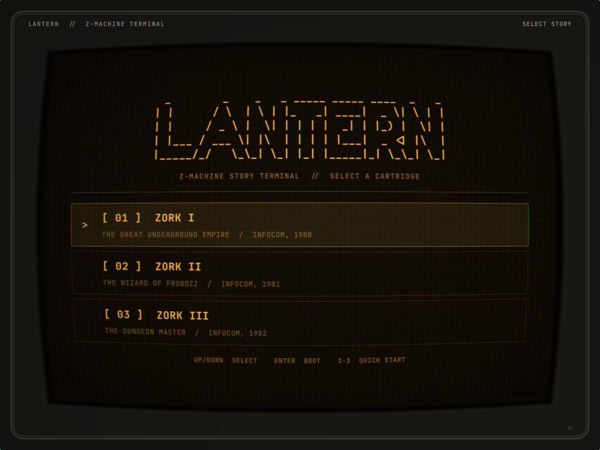
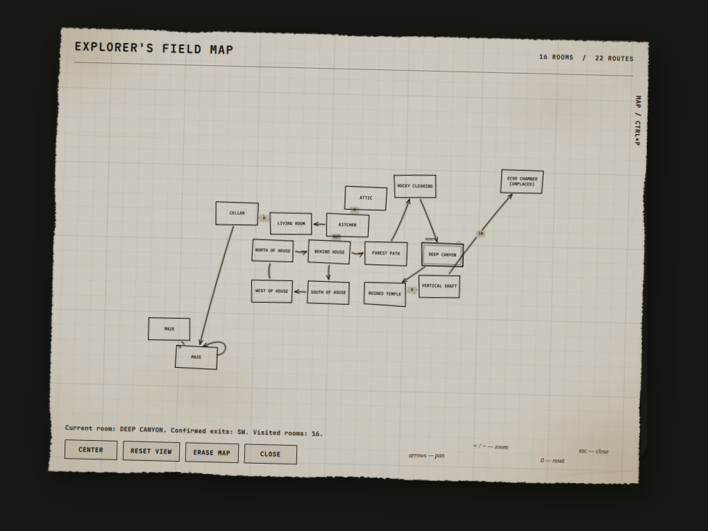

# LANTERN

> Development checkout targeting **0.2.0**; the latest published release remains **0.1.7**. See `docs/release-0.2.0-plan.md` for validation results and outstanding release gates. Native helper binaries in this candidate were rebuilt locally with GCC 16.2.1; they still need replacement and verification using the documented pinned GCC 14.2.0 build before release.

LANTERN is a standalone Omarchy Quattro plugin for playing classic interactive fiction inside a restrained early-1980s monochrome CRT window.

Its engine bay currently carries Frotz for Z-machine stories, Open Adventure for Colossal Cave, and ScottFree for user-supplied Scott Adams-format databases. LANTERN supplies the panel, phosphor display, cartridge library, command entry, history, and session persistence while the Omarchy shell remains alive.



## Install

```bash
omarchy plugin add https://github.com/OldJobobo/lantern.git --enable
```

That is the complete installation. LANTERN includes its own `dfrotz`, `advent`, and `scottfree` runtimes, MIT-licensed copies of the complete Zork trilogy, and the BSD-licensed Open Adventure version of Colossal Cave Adventure. It runs no installer, requests no elevated privileges, downloads no assets on first launch, and requires no separate package.

To uninstall the plugin safely:

```bash
omarchy plugin remove jobo.lantern --yes
```

Saved games and window placement are intentionally retained under `${XDG_STATE_HOME:-~/.local/state}/lantern`. Remove that directory separately only if you also want to erase your saves.

Enabling LANTERN adds its monochrome lantern icon to the right side of the Omarchy bar. It follows the bar foreground while idle; during an active story it shifts to the current theme's `yellow` color and emits a slow phosphor-like pulse. Click it to open or hide the terminal. You can also summon it from the command line:

```bash
omarchy-shell shell summon jobo.lantern '{}'
```

## Platform support

The bundled runtime currently supports **x86-64 glibc Linux**, matching current Omarchy systems. It has no dependencies beyond glibc.

## Games and appearance

LANTERN opens with its original ASCII logo and a dedicated engine menu. Choose **Z-Machine**, **Open Adventure**, or **Scott Adams**, then press `Enter` to open that engine's separate cartridge bay. Z-Machine carries Zork I–III and imported Z1–Z8 stories, Open Adventure carries the bundled 430-point **Colossal Cave Adventure**, and Scott Adams accepts user-supplied TRS-80-format `.dat` databases. `Escape`, `Left`, or `B` returns from a cartridge bay to the engine menu.

Press `I` in the Z-Machine or Scott Adams bay to import a local cartridge through a separate desktop file picker, isolated from the Quickshell process. Lantern validates Z-machine headers and Scott Adams database bounds, rejects symlinks and special files, enforces format-specific size limits, then atomically copies the story into its managed cartridge library. The original file is never launched in place.

Lantern bundles the GPL-licensed ScottFree interpreter but **does not bundle the original Scott Adams adventures**. Those game databases remain separately copyrighted; import only `.dat` files you have obtained legally.

For safety, the public summon interface accepts only the four bundled cartridge IDs (or the legacy exact Zork story paths). Imported stories can be launched only after they have been validated and copied into Lantern's managed library; arbitrary summon paths remain rejected.

The illustrated RGB button cycles between amber, green phosphor, and an Omarchy-aware mode that uses the active theme's terminal foreground and background colors. Each button press briefly knocks the channels into stacked horizontal slices before they settle into the new palette, like a hardware switcher catching sync. Summon payloads and `lantern.toml` accept `amber`, `green`, or `theme`; the legacy `white` value remains available for compatibility. The CRT shader gives the raster adjustable analog life: content-aware scanline depth, subpixel line weave, bloom between illuminated lines, a slow refresh band, and low-level power flutter. Pass `"effects":false` for an undistorted, motion-free display:

```bash
omarchy-shell shell summon jobo.lantern \
  '{"effects":false,"phosphor":"amber"}'
```

## Configuration

LANTERN ships a documented [`lantern.toml`](lantern.toml) with complete defaults. To create an update-safe personal override, copy it outside the plugin checkout:

```bash
config_root="${XDG_CONFIG_HOME:-$HOME/.config}"
mkdir -p "$config_root/lantern"
cp "$config_root/omarchy/plugins/jobo.lantern/lantern.toml" \
  "$config_root/lantern/lantern.toml"
```

LANTERN polls both files and reloads changes while the Omarchy shell is running. The personal file overrides the bundled defaults. Every mutable configuration and theme path used by the panel or bar widget is read through a 64 KiB bounded native helper that atomically rejects symlinks, non-regular files, and blocking inputs. Available settings cover phosphor color, CRT enablement, BRIGHT dial position and maximum gain, cursor fade timing, command-history and transcript limits, initially selected cartridge, and mouse-wheel dial step. Invalid numeric values are clamped to safe ranges.

## Controls

- **Bar icon:** open or hide LANTERN
- **Drag the top label strip:** move the terminal
- **RGB button:** cycle amber, green-phosphor, and current Omarchy theme colors
- **SCALE button:** cycle the Lantern window independently through 1×, 1.25×, and 1.5×
- **BRIGHT dial:** drag or scroll the illustrated CRT control to adjust the animated raster layer without changing the tube geometry
- **Engine menu Up/Down:** select an engine
- **Engine menu Enter:** open that engine's cartridge bay
- **Cartridge bay Up/Down:** select a cartridge
- **Cartridge bay Enter:** boot the selected cartridge
- **Cartridge bay Escape/Left/B:** return to the engine menu
- **Launcher I:** import a Z1–Z8 story or Scott Adams `.dat` database into the selected engine library
- **MAP button / Ctrl+P:** open or close the explorer map for the verified Zork I cartridge
- **Map Escape:** close the map before closing Lantern
- **Map arrows / Shift+arrows:** pan; **+ / −:** zoom; **0:** recenter
- **Game Enter:** submit command
- **Game Up/Down:** command history
- **SAVE button, Ctrl+S, or `SAVE [name]`:** open the Memory Bank and write a named save
- **LOAD button, Ctrl+L, `RESTORE [name]`, or `LOAD [name]`:** select and restore a saved game
- **Game MENU button or Ctrl+M:** end the current story process and return to the cartridge launcher
- **Escape:** hide LANTERN while leaving the game process alive

Closing the native window also preserves the game process. LANTERN rebuilds the `FloatingWindow` on the next bar click so compositor-close and reopen cycles remain reliable.

LANTERN remembers the window's monitor and monitor-relative position when it closes. Before the next window is mapped, it installs a temporary Hyprland initial-placement rule for that saved geometry, then removes the rule after creation. The window therefore starts at its persistent location rather than appearing at center and moving afterward. If the saved monitor is unavailable, the compositor's normal placement is left untouched.

The terminal uses a 1020×765 logical-pixel base calibrated for Frotz's 76-column output. Its SCALE button enlarges that complete surface to 1.25× or 1.5× without changing the rest of the Omarchy shell. Transcript lines never soft-wrap and sit inside a curvature-safe inset so the illustrated tube edge cannot obscure them. The top label strip invokes native window movement. The illustrated bezel, tube well, glass lip, and distorted image share one shader-derived curved edge so the physical frame follows the CRT geometry.

For Z-machine and Scott Adams cartridges, the in-screen **Memory Bank** handles the interpreter's filename protocol before sending commands to the interpreter, so prompts without trailing newlines cannot disappear. New saves receive a story-and-timestamp suggestion, names are constrained to safe filename stems, existing saves require overwrite confirmation, and restore presents the selected engine's readable save files newest-first. Escape cancels before any interpreter command is sent. Raw `SAVE` and `RESTORE` commands are intercepted into the same flow; Z-machine `LOAD` is accepted as a modern alias for `RESTORE`. ScottFree saves use `.sav`; Z-machine saves use `.qzl`.

Open Adventure uses its upstream autosave mode instead. Returning to Lantern's menu checkpoints Colossal Cave automatically, and the next launch resumes that session.

Frotz and ScottFree save and restore access remains restricted to:

```text
${XDG_STATE_HOME:-~/.local/state}/lantern/saves
```

Open Adventure's autosave is stored under `saves/open-adventure/` as `colossal-cave-1.22.sav`. ScottFree saves are isolated by cartridge under `saves/scottfree/`. Imported cartridges are stored separately at:

```text
${XDG_DATA_HOME:-~/.local/share}/lantern/cartridges
```

Window geometry is stored at:

```text
${XDG_STATE_HOME:-~/.local/state}/lantern/window.json
```

## Bundled third-party software

LANTERN includes:

- Frotz 2.55 `dfrotz`, licensed under GPL-2.0-or-later
- Zork I, II, and III from the corresponding `historicalsource/zork1`, `zork2`, and `zork3` repositories, licensed under MIT
- Open Adventure 1.22 `advent`, a BSD-2-Clause forward-port of Crowther and Woods' Adventure 2.5
- ScottFree 1.14 `scottfree`, licensed under GPL-2.0-or-later; no original Scott Adams game data is bundled

See [`THIRD_PARTY_NOTICES.md`](THIRD_PARTY_NOTICES.md), the bundled source and build provenance under `third_party/frotz/`, `third_party/open-adventure/`, and `third_party/scottfree/`, and the checksum inventory at `third_party/SHA256SUMS`.

The original bounded-reader helper has [documented build provenance](docs/read-bounded-file-provenance.md). Its executable is reproducibly built with a digest-pinned GCC container, checksummed alongside its reviewed C source, and rebuilt byte-for-byte in CI.

The repository-level MIT license applies to original LANTERN code and materials except the ScottFree stdio adapter under `third_party/scottfree/stdio-glk/`, which is GPL-2.0-or-later for direct linkage with ScottFree. Lantern does not relicense bundled third-party components.

## Explorer map

0.2.0 automapping is deliberately limited to the bundled **Zork I** story, identified by its exact content fingerprint. A byte-identical imported copy also qualifies. Zork II/III, other imported Z-machine stories, ScottFree, and Open Adventure remain playable but do not enable mapping. Engine support alone is not proof of reliable room observation.

The neutral graph-paper overlay stays outside the CRT shader and draws only observed rooms and confirmed directed traversals. It never sends a hidden game command. Opening it preserves the command draft, owns focus and pointer input, and does not advance the game. `ERASE MAP` requires confirmation and erases only that cartridge's cumulative map, not game saves.

Maps are stored independently of save slots under:

```text
${XDG_STATE_HOME:-~/.local/state}/lantern/maps/zmachine-<sha256>.json
```

Restore/restart reacquires the current room without fabricating a route. Corrupt or unsupported map state is ignored without preventing game launch. If map writes fail, check state-directory permissions: the shared `lantern` parent must be user-owned and not group/world-writable; `maps` must be mode `0700` and map files `0600`.

Set `[audio] mute = true` to disable paper sounds or adjust `paper_volume` between 0 and 1 (default `0.18`). `[accessibility] reduce_motion = true` replaces travel with immediate transitions and suppresses travel sounds. These settings are independent of the existing CRT `display.effects` control. Missing audio never blocks the map. A text summary provides the current room, confirmed exits, and visited count.



The preview above demonstrates rendering, not a precomputed map used in gameplay.

## Validation

```bash
./tests/run
./tests/smoke-panel
LANTERN_QPA_PLATFORM=wayland ./tests/smoke-panel
QT_QPA_PLATFORM=offscreen /usr/lib/qt6/bin/qmltestrunner -input tests/qml -o -,txt
./scripts/build-bounded-reader /tmp/read-bounded-file
cmp bin/read-bounded-file /tmp/read-bounded-file
./scripts/build-cartridge-helper /tmp/lantern-cartridge
cmp bin/lantern-cartridge /tmp/lantern-cartridge
./scripts/build-open-adventure /tmp/advent
cmp runtime/x86_64-linux/advent /tmp/advent
./scripts/build-scottfree /tmp/scottfree
cmp runtime/x86_64-linux/scottfree /tmp/scottfree
sha256sum -c third_party/SHA256SUMS
./tests/smoke-runtime
omarchy plugin validate .
qmlformat Panel.qml >/dev/null
/usr/lib/qt6/bin/qsb --qt6 -o /tmp/crt.frag.qsb shaders/crt.frag
```

The compiled `shaders/crt.frag.qsb` asset is loaded at runtime; rebuild it with Qt Shader Baker after changing `shaders/crt.frag`.

Static validation is not a substitute for opening the panel in a live Quattro shell. Release verification includes a fresh `omarchy plugin add` installation and live gameplay smoke on Omarchy.

## Development

Quattro installs third-party plugins as ordinary Git checkouts under:

```text
~/.config/omarchy/plugins/jobo.lantern
```

The manifest identity and repository layout must remain compatible with that exact destination.

## License

LANTERN's original code is MIT licensed. See [`LICENSE`](LICENSE). Bundled components retain the licenses listed above.
